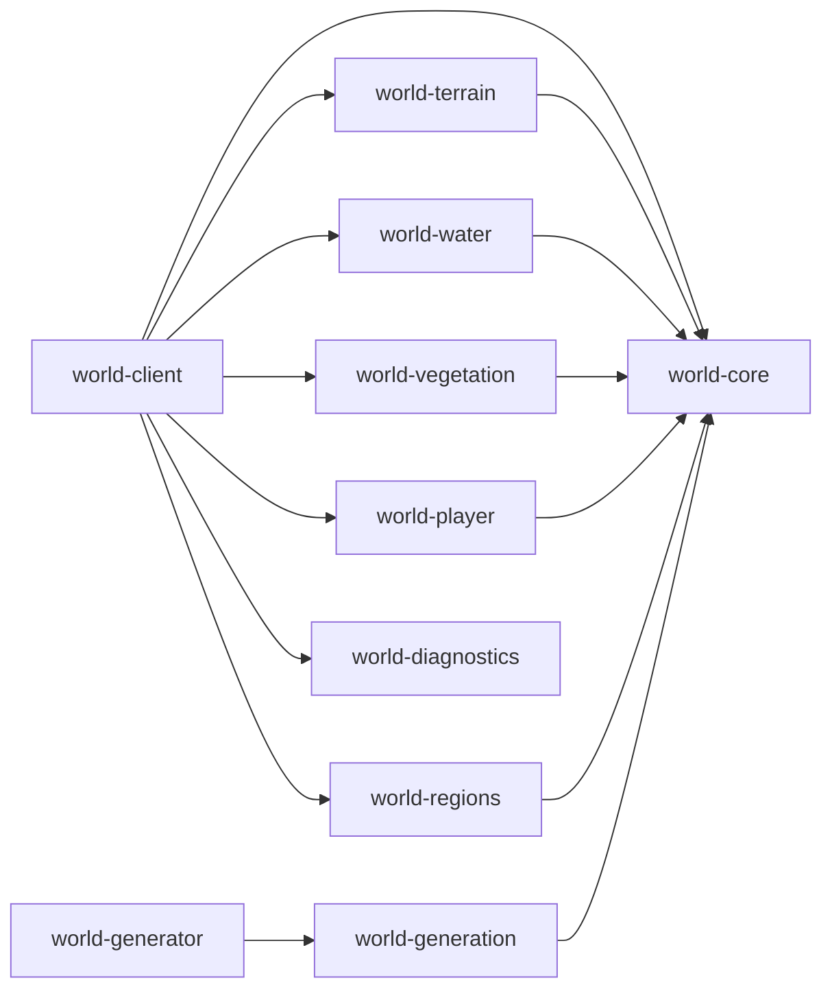

# Planetary world workspace

The Bevy 0.14 client composes independently owned subsystems. The offline
generator writes the existing cube-sphere asset formats. The separately deployed
`Epic_Game_V/` PostgreSQL economy service has its own manifest and lockfile and
is excluded from this workspace.

Before the extraction, startup registered the main systems and materials in
`main.rs`. Forest, terrain, and water identified the camera through its debug
controller, while river map lines queried the private player component. Forest
also inferred first-person mode from the player's projection constants.
The generator pulled in Bevy through the client package.
The workspace moves those connections into the contracts below.

## Ownership

| Owner | Owns | Public entry point |
| --- | --- | --- |
| `world-core` | Legacy cube-sphere coordinates, planet constants, region IDs and spawn contract, height and river coverage queries, asset directory, floating-origin frame, shared components and sets | `coordinates`, `planet`, `SurfaceHeights`, optional `runtime` |
| `world-generation` | Procedural planet baking, heightmaps, drainage, rivers, water classification and legacy output files | `generate_world(&Path)` |
| `world-terrain` | Adaptive terrain chunks, terrain material and textures, lighting and atmospheric fog | `TerrainPlugin` |
| `world-water` | Ocean patches and bathymetry, river meshes and map lines, ocean and river shaders and shared water shader code | `WaterPlugin` |
| `world-vegetation` | Biome placement, ground cover, forests, Hero Oak models and LODs, foliage and distant-forest shaders | `ProceduralForestPlugin` |
| `world-player` | Explorer movement and animation, input and camera modes, travel UI and destination marker | `PlayerPlugin::new(ExplorerSpawn)` |
| `world-regions` | Authored region definitions and their spawn placements. The starter river region is the first definition. | `Region`, `STARTER_REGION` |
| `world-diagnostics` | FPS and CPU frame-time overlay | `FrameStatsPlugin` |
| `apps/world-client` | Bevy configuration, asset root, region selection, registration of subsystem plugins | `world-client` binary |
| `apps/world-generator` | Command-line entry point and the default output directory | `generate_world` binary |

The terrain owner maintains `assets/shaders/spherical.wgsl` and
`assets/textures/terrain/`. The water owner maintains `ocean.wgsl`,
`river_water.wgsl`, and `water_common.wgsl`. The vegetation owner maintains
`foliage.wgsl`, `distant_forest.wgsl`, `assets/models/hero_oak/`, and their
source exports and build tooling. Generator outputs in `assets/world/` and
`assets/terrains/spherical/source/height/` are shared with runtime consumers.
Coordinate changes to their layout and encoding with core and the affected
consumers.

## Dependency graph

Arrows point from a consumer to its dependency. The graph shows production
workspace dependencies.



The player and vegetation tests use the public starter region as a fixture.
Generation and regions use the core data API. The optional core `runtime`
feature adds Bevy integration and the existing `../bevy_terrain` path dependency
with `high_precision`. The player uses that dependency's debug camera separately.
The generator builds without the Bevy renderer or the path crate.

## Spatial and scheduling contracts

- **Coordinates.** Use `DVec3` for planet-centered positions in meters. The
  reference sphere has a radius of 3,389,500 m. A unit radial direction identifies
  a point on the surface, and elevation is relative to the sphere. Keep
  positions in double precision through CPU placement and sampling. Use
  `ReferenceFrame::translation_to_grid` when placing entities and
  `grid_position_double` when reading them. Use Bevy's floating-origin
  `GlobalTransform` for render-space operations such as frustum tests.
- **Terrain data.** `world-core::coordinates` owns the legacy cube face order,
  warp, and baked texel alignment. Use `terrain_aligned_direction` once when
  moving an authored or generated source direction into the runtime space.
  Use `cube_direction` for baked tile UVs and `SurfaceHeights::sample` for a
  runtime direction. The river mask is queried from the same service.
  Generation uses the legacy scalar source mapping to preserve exact output.
- **Forest canopy.** Vegetation publishes `world_core::canopy::ForestCanopy`
  for the terrain material. A versioned offline bake samples canonical tree
  patches to produce six 1024² cube faces. A background worker prepares their
  mip chain and the renderer stages at most 1 MiB of orbital texture per
  frame. Camera-centered layers supplement the cubemap at finer resolutions.
  Near the impostor handoff, full tree patches supply species-specific crown
  silhouettes and relief. Terrain blends these by screen footprint and
  distance, independently of terrain chunk size. See the
  [canopy bake and camera sweep](../crates/world-vegetation/README.md#orbital-canopy).
- **Startup.** The client disables Bevy's `TransformPlugin` before installing
  `WorldSpacePlugin`. In `Startup`, `WorldReady` publishes the planet's root
  frame and read-only `SurfaceHeights`. Player and water startup systems run
  after that phase. `PlanetRoot` supplies the parent for planet entities.
- **Gameplay and streaming.** The player publishes the shared `Explorer`
  marker and `WorldCamera` mode. In `Update`, `WorldMovement` precedes terrain
  and vegetation streaming. Vegetation has no dependency on player code.
- **Rendering.** In `PostUpdate`, the player's free camera runs in
  `CameraMotion` before transform propagation. Ocean culling follows camera
  motion, river map lines follow propagation, and forest visibility runs
  between Bevy's frustum update and visibility propagation. The terrain
  atmosphere also reads the camera after camera motion.

## Adding a subsystem or region

1. Agree on ownership and start in a separate feature worktree. Extend an
   existing crate if the subsystem belongs to its responsibility.
2. Put new region data in `world-regions`. Define the authored coordinates
   there and pass shared data through the client composition root. Avoid
   dependencies from the region catalog into rendering or player internals.
3. For a new independently owned runtime subsystem, expose a documented Bevy
   plugin and keep its systems and render resources private. Use existing
   shared contracts where possible. Coordinate additions to core before
   introducing a component, resource, schedule set, or event used by multiple
   subsystems.
4. Add tests within the subsystem and register the plugin in
   `apps/world-client/src/main.rs`. Update the ownership table and graph when
   adding a crate. Follow [the review workflow](../AGENTS.md).

## Running and testing

Keep this repository and `bevy_terrain` as sibling checkouts. Run commands from
the workspace root. The client needs a graphics-capable Bevy environment.
Linux keeps dynamic Bevy linkage for faster client rebuilds.

```sh
cargo run --locked -p world-client
cargo fmt --all --check
cargo check --workspace --all-targets
cargo test --workspace

cargo check -p world-vegetation --all-targets
cargo test -p world-vegetation
cargo test -p world-generation
```

The client resolves `assets/` from `BEVY_ASSET_ROOT` when set, then from the
working directory, the executable directory, or the source checkout. Bevy and
the synchronous world data readers use the same resolved directory.

Run the generator from the workspace root to regenerate the files it owns.
It writes under `assets/` in its working directory and overwrites generated
files. Build it first and run the executable from a scratch directory for an
isolated bake.

```sh
cargo run --locked -p world-generator

cargo build --locked -p world-generator
generator="$PWD/target/debug/generate_world"
scratch="$(mktemp -d)"
(cd "$scratch" && "$generator")
```

## Refactor verification

Before extraction, `cargo check --locked --offline --all-targets` succeeded and
all 27 existing tests passed. The baseline formatting check reported differences
in four Rust files.

The workspace formatting check, all-targets check, and 33 tests passed after
extraction. The integration tests boot the client plugins without a graphics
device, verify the map, first-person, and free camera modes, and run the
generator in a temporary working directory. A separate before-and-after bake
produced 21 byte-identical files. The original assets and shaders also matched
their pre-refactor checksums.

The client plugin composition rendered 56 frames on Mesa llvmpipe with an
offscreen camera target, including the map and first-person views. Native
window startup was limited by the sandbox's X11 socket permissions. The
offscreen run logged a gamepad hot-plug error and UI target warnings.

## Remaining shared assumptions

The runtime has one planet reference frame, one world camera, and one primary
explorer. Most systems read world heights through one synchronously loaded
resource. The ocean packs bathymetry from legacy height-face texels for its
shader, and both renderers and the baker depend on the same face orientation and
height encoding. Coordinate or asset-format changes therefore require joint
review. The path dependency still emits its existing compiler warnings.
